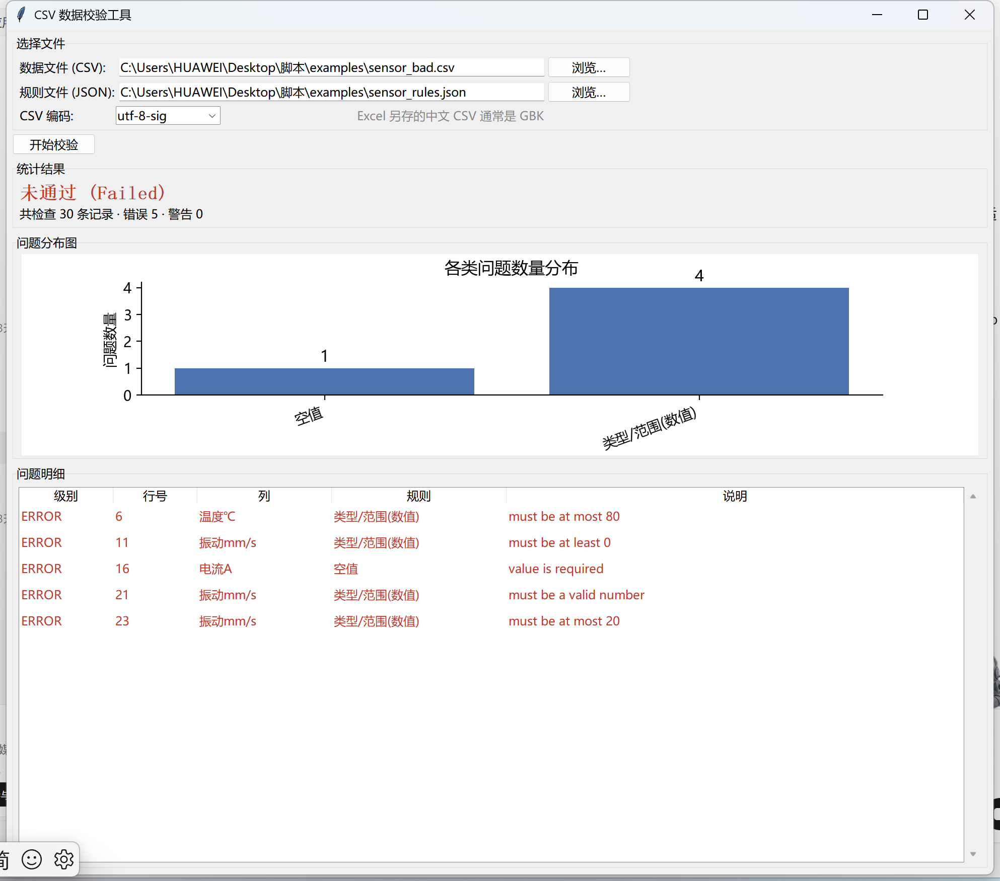
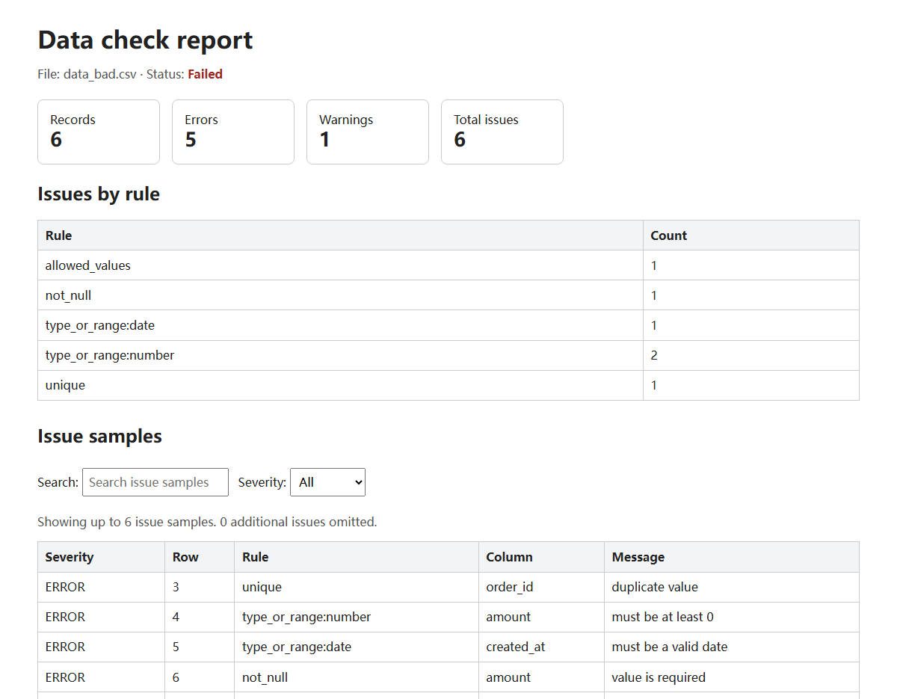

# csv-validator

一个用 JSON 规则配置来校验 CSV 数据的命令行工具，附带可选的桌面图形界面。

不需要写代码，只需准备一份规则文件（JSON），就能检查 CSV 里的空值、重复值、数据类型、数值范围、日期格式、枚举值等常见问题，并输出 JSON 或 HTML 报告。

## 效果预览

桌面图形界面（tkinter + matplotlib，支持中文列名、编码切换）：



命令行生成的交互式 HTML 报告（支持搜索和按级别筛选）：



## 安装

从源码安装（推荐，当前版本尚未发布到 PyPI）：

```bash
git clone https://github.com/0mengshu/csv-validator
cd csv-validator
pip install .            # 命令行工具，零第三方依赖
pip install ".[gui]"     # 需要图形界面时，额外安装 matplotlib
```

安装后即可直接使用 `data-check` 命令：

```bash
data-check --version
data-check data.csv --config rules.json
```

不安装也可以直接用 `python data_check.py ...` 运行。

## 功能特性

- **必填列检查** —— 缺失的列会报错
- **非空检查** —— 指定列不允许为空
- **唯一性检查** —— 单列或列组合不允许重复
- **类型与范围检查** —— 支持 `string`、`integer`、`number`、`date`、`boolean` 五种类型，数值可设置上下限
- **枚举值检查** —— 指定列只能是预设值
- **严重级别** —— 每个规则可设为 `error`（不通过）或 `warning`（仅提示，不判失败）
- **多种报告** —— 输出 JSON 完整报告，或带搜索/筛选的交互式 HTML 报告

## 环境要求

- Python 3.10 及以上
- **命令行工具（`data_check.py`）**：只用 Python 标准库，无第三方依赖
- **图形界面（`gui.py`）**：额外需要 [matplotlib](https://matplotlib.org/)

```bash
pip install -r requirements.txt   # 或 pip install matplotlib
```

## 图形界面

不想用命令行的话，可以启动桌面图形界面（tkinter）：

```bash
python gui.py          # 或安装后直接运行 data-check-gui
```

界面支持选择数据文件、规则文件和 CSV 编码（Excel 另存的中文 CSV 通常是 GBK），校验结果以表格和柱状图展示。

各平台注意：

| 平台 | 说明 |
|------|------|
| Windows | Python 官方安装包自带 tkinter，开箱即用 |
| macOS | 官网安装的 Python 自带 tkinter；Homebrew 版需 `brew install python-tk` |
| Linux | 需安装 tkinter：`sudo apt install python3-tk`（Debian/Ubuntu）或 `sudo dnf install python3-tkinter`（Fedora） |

图形界面的图表会自动选择本机可用的中文字体（微软雅黑 / 苹方 / Noto / 文泉驿等）；若系统一个中文字体都没有，图表中的中文会显示为方块，可安装任一中文字体解决。

## 快速开始

仓库的 [examples/](examples/) 目录自带可直接试跑的演示数据（含一份故意有错的 `data_bad.csv`）：

```bash
python data_check.py examples/data_bad.csv --config examples/rules.json
```

也可以用自己的数据：

1. 克隆仓库

```bash
git clone https://github.com/0mengshu/csv-validator
cd csv-validator
```

2. 准备一份 CSV 文件，例如 `data.csv`

```csv
order_id,amount,created_at,status
A001,100.50,2024-01-15,paid
A002,-5.25,2024-02-30,cancelled
```

3. 准备一份规则文件，例如 `rules.json`

```json
{
  "required_columns": ["order_id", "amount", "created_at", "status"],
  "not_null": ["order_id", "amount", "created_at"],
  "unique": [["order_id"]],
  "columns": {
    "amount": { "type": "number", "min": 0 },
    "created_at": { "type": "date", "format": "%Y-%m-%d" }
  },
  "allowed_values": {
    "status": ["pending", "paid", "cancelled"]
  }
}
```

4. 运行校验

```bash
python data_check.py data.csv --config rules.json
```

输出结果示例：

```
Checked 2 records: 3 error(s), 0 warning(s); 0 omitted from issue samples.
```

命令退出码：`0` 表示通过，`1` 表示存在 `error` 问题，`2` 表示配置或运行时错误。

## 生成报告

输出 JSON 完整报告：

```bash
python data_check.py data.csv --config rules.json --report report.json
```

输出交互式 HTML 报告（支持搜索和按严重级别筛选）：

```bash
python data_check.py data.csv --config rules.json --html-report report.html
```

## 配置说明

规则文件是一个 JSON 对象，支持以下键：

| 键 | 类型 | 说明 |
|----|------|------|
| `required_columns` | 字符串列表 | 必须存在的列名 |
| `not_null` | 字符串列表 | 不允许为空的列名 |
| `unique` | 列表的列表 | 唯一性约束，每个元素是一组列名（列组合唯一） |
| `columns` | 对象 | 每列的校验规则，见下方说明 |
| `allowed_values` | 对象 | 列名 -> 允许的取值列表 |
| `max_issues` | 整数 | 报告中保留的问题样本数上限（默认 200） |
| `severity` | 对象 | 规则名 -> `error` 或 `warning` |

### `columns` 规则

每列是一个对象，键：

| 键 | 说明 |
|----|------|
| `type` | 必填，`string`/`integer`/`number`/`date`/`boolean` 之一 |
| `min` | 最小值（仅 `integer`、`number`） |
| `max` | 最大值（仅 `integer`、`number`） |
| `format` | 日期格式，仅 `date` 类型必填，如 `%Y-%m-%d` |

### `severity` 支持的规则名

`required_column`、`not_null`、`unique`、`type_or_range`、`allowed_values`、`row_width`。

`type_or_range` 可以加上冒号后缀精确指定类型（后缀必须是五种类型之一），例如 `"type_or_range:number": "warning"` 只影响 `number` 类型。

> 说明：无论列是被 `required_columns`、`not_null` 还是 `columns` 等引用，**缺失的列统一按 `required_column` 报告且只报一次**。`column_rule` 为兼容旧配置保留，正常流程不会再触发。

完整可运行的示例见 [examples/rules.json](examples/rules.json)，另附一组传感器演示数据（`sensor.csv` / `sensor_bad.csv` / `sensor_rules.json`，含中文列名）。

## 运行测试

```bash
python -m unittest test_data_check.py
```

## License

[MIT](LICENSE)